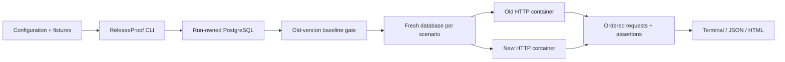

# ReleaseProof

**Catch database migrations that break running applications before deployment.**

A migration can succeed while the old application fails during a rolling
deployment. ReleaseProof starts real old and new HTTP application containers
against isolated PostgreSQL databases and checks that both versions can still
read, write, and understand each other's data.

You supply the application checks and business assertions. ReleaseProof supplies
the baseline gate, clean database state, cross-version execution, and evidence.

<!-- ACTUAL_DEMO_OUTPUT -->

## Try the rolling-deployment demo

Requirements: **Go 1.27.4**, a running local **Linux Docker Engine**, and access to
the Go module proxy and container registry on the first run. Docker Desktop must
use Linux containers. The fixture uses PostgreSQL `17.12-alpine`.

From the repository root:

```sh
go build -o bin/releaseproof ./cmd/releaseproof
bin/releaseproof check --config examples/rolling-deployment/unsafe.yaml
bin/releaseproof check --config examples/rolling-deployment/safe.yaml
```

The unsafe command should exit **1**: the migration drops `users.full_name` while
the old version still queries it. The new version reads the split fields. The safe
command should exit **0**: a database trigger preserves both representations
through the supported coexistence phase, including writes in both directions.

To run directly from source:

```sh
go run ./cmd/releaseproof check --config examples/rolling-deployment/unsafe.yaml
go run ./cmd/releaseproof check --config examples/rolling-deployment/safe.yaml
```

`go run` prints `exit status 1` for the expected unsafe failure; use the built
binary when a script needs ReleaseProof's exact exit code. On Windows, invoke
`bin/releaseproof.exe`.

A third demonstration catches a subtler defect:

```sh
bin/releaseproof check --config examples/rolling-deployment/semantic.yaml
```

Both applications return HTTP 200, but successful writes leave the other version's
fields stale. JSON assertions expose the mismatch. See the
[demo walkthrough](examples/rolling-deployment/README.md) for the synchronization
invariant and the later old-version retirement step.

## The compatibility matrix

| Check | Schema | Question |
| --- | --- | --- |
| Old application baseline | Original | Did the declared behavior work before the change? |
| Old application after migration | Migrated | Can the still-running old version operate? |
| New application after migration | Migrated | Can the new version operate? |
| Old writes → new reads | Migrated | Does the new version understand old writes? |
| New writes → old reads | Migrated | Does the old version understand new writes? |
| Optional mixed sequence | Migrated | Do additional ordered interleavings preserve the contract? |

Every scenario starts from the baseline schema and deterministic fixtures in a
fresh database. A failed baseline stops migration comparison. An infrastructure
failure remains an execution failure, even if other scenarios pass.

## Use it in your project

```sh
bin/releaseproof init
bin/releaseproof validate --config releaseproof.yaml
bin/releaseproof check --config releaseproof.yaml
```

`init` creates a complete small example without overwriting existing files.
Configure the baseline and migration SQL, old/new images or Docker build contexts,
readiness endpoints, and meaningful HTTP assertions. No ReleaseProof library needs
to be added to your application.

The configuration is strict, versioned YAML. Requests support GET, POST, PUT,
PATCH, DELETE, and HEAD; expected status codes; JSON pointer equality assertions;
response captures; and references to previous captures. Read the
[configuration guide](docs/configuration.md) or start with the complete
[safe example](examples/rolling-deployment/safe.yaml).

Build from a reviewed checkout, or install a specific reviewed commit:

```sh
go install github.com/REinstall-SyS/ReleaseProof/cmd/releaseproof@<reviewed-commit>
```

Replace `<reviewed-commit>` with an actual commit before running that command. No
package-registry publication or downloadable release is implied.

## Reports and reproduction

Each check prints a terminal report and writes `report.json` and a self-contained
`report.html`. The default location is relative to the configuration file:

```text
.releaseproof/<run-id>/report.json
.releaseproof/<run-id>/report.html
```

Reports include scenario and step results, exact failed assertions, HTTP/SQL
errors, application versions, migration paths, bounded logs, resolved image
identities, risks, timings, and reproduction commands. Static warnings are separate
from observed application failures. Credentials and recognized connection strings
are redacted; use synthetic fixtures and review reports before sharing them.

Rerun one scenario with its baseline gate using the path printed by the original
check:

```sh
releaseproof reproduce old-after --report path/to/report.json
```

Reproduction verifies recorded source inputs and image identities. It needs the
local configuration, SQL/build inputs or images, and report; it does not archive
them. Changed inputs require an explicit fresh experiment. See
[reproduction](docs/reproduction.md).

| Exit | Meaning |
| --- | --- |
| 0 | Supplied compatibility contract passed |
| 1 | Observed compatibility failure after a valid baseline |
| 2 | Configuration or command error |
| 3 | Baseline, infrastructure, execution, or cleanup failure |

## CI integration

Run the CLI as a normal deployment gate on a Linux runner with Docker:

```yaml
- name: Check rolling-deployment compatibility
  run: bin/releaseproof check --config releaseproof.yaml
```

An unsafe rollout fails the step. Keep generated JSON/HTML as CI artifacts so the
failure is reviewable. The [CI guide](docs/ci.md) includes a complete workflow and
the distinction between a real deployment gate and a demo expected to fail.

## How it works



The implementation uses Go, Cobra, a maintained YAML parser, pgx, the Docker CLI,
and PostgreSQL's own SQL interpreter and catalogs. Application tests use restricted
database credentials; migrations use separate ephemeral database owners. Docker
commands use argument arrays, context cancellation, unique ownership labels, and
bounded cleanup. Read the [architecture](docs/architecture.md) for the design.

## Testing and measurements

```sh
go test ./...
go vet ./...
go test -tags integration -count=1 -timeout 25m ./internal/runner
make e2e
python scripts/benchmark.py --runs 3
```

Integration and end-to-end checks require real PostgreSQL and application
containers. They cover migration validity, removed columns, semantic divergence,
compatible coexistence, startup failures, cancellation, isolation, cleanup, reports,
and reproduction. Unit tests cover configuration, assertions, variable extraction,
planning, redaction, serialization, and exit decisions. See
[recorded validation](docs/validation.md) for what was actually executed.

The benchmark script records machine/Docker details, fixture size, run count,
startup, migration, scenario, and total durations. A first local invocation is
reported separately from repeated invocations; existing registry/image/build caches
affect startup cost. No performance figures are claimed without recorded output.

## Trust and scope

Run trusted images, SQL, and build contexts on a disposable local development or
CI Docker daemon. Docker is not a complete sandbox for hostile code. ReleaseProof
creates its own database; it does not accept a production database as a target.
The MVP grants and catalog analysis cover the `public` schema.

A passing run covers the declared fixtures and assertions. It does not infer
business rules, exercise production traffic, guarantee production lock behavior,
or prevent every outage. Static DDL warnings are conservative, and local timings
are not production downtime predictions. Read the [security model](docs/security.md)
and [known limitations](docs/limitations.md).

Contributions are welcome through focused, tested changes; see
[CONTRIBUTING.md](CONTRIBUTING.md). Licensed under [MIT](LICENSE).
