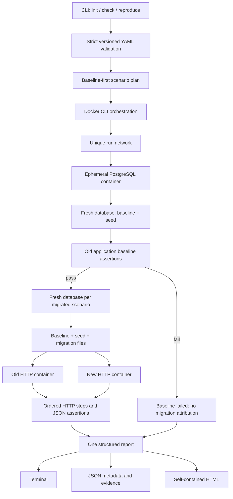

# Architecture

ReleaseProof executes a developer-authored compatibility contract. It controls
database state, starts application versions, sends HTTP requests, compares their
results with explicit assertions, and records evidence. It does not infer business
requirements from SQL or application code.

## Ownership and isolation

Each invocation generates a random run identifier. Its Docker network, PostgreSQL
container, application containers, and locally built image tags use that identifier
and the `io.releaseproof.run` ownership label. Concurrent invocations therefore do
not share names, databases, or application credentials.

The PostgreSQL server is shared only within one invocation. Every scenario starts
with a new database, a separate migration owner login, and a restricted application
login. The schema and deterministic seed files are loaded again for that scenario.
Migration owners can manage their own database objects. Application users receive
table `SELECT`, `INSERT`, `UPDATE`, and `DELETE` privileges and the sequence
privileges required by normal inserts; they do not receive migration-owner or
superuser credentials. Application containers for a scenario use only that
scenario's connection string.

Container HTTP ports bind to dynamically assigned `127.0.0.1` ports. The application
connects to PostgreSQL through the run's Docker network. Only local Linux Docker
daemons reached through a Unix socket or Windows named pipe are supported. Remote
daemon TCP/SSH endpoints are rejected because their published ports are not the
local runner's loopback interface.

## Baseline gate and compatibility matrix

All `baseline` scenarios execute before any migrated scenario. The baseline gate
requires the old application to pass its supplied assertions against the baseline
schema and fixtures. A failed baseline produces `baseline_failed` and execution
exit code 3. It is not evidence that a migration caused a regression.

After that gate passes, the required scenario kinds test:

| Kind | Database | Intended contract |
| --- | --- | --- |
| `baseline` | Baseline and seed | Old application works before the change |
| `old_after` | Baseline, seed, migrations | Old version still works |
| `new_after` | Baseline, seed, migrations | New version works |
| `old_to_new` | Baseline, seed, migrations | Old mutation is read correctly by new |
| `new_to_old` | Baseline, seed, migrations | New mutation is read correctly by old |
| `mixed` | Baseline, seed, migrations | Additional ordered interleaving |

Cross-version scenarios require an appropriate writer mutation followed by the
other application's GET with JSON assertions. This shape check establishes a
useful minimum contract; developers still choose representative requests and
expected values. Additional scenarios of a kind can cover more operations.

Both application versions may run simultaneously in one scenario. Requests execute
once, in their declared order, without retries or parallel step execution.
Readiness probes are the only HTTP operations retried. Captured variables are
published after a successful step and exist only within their scenario. A failing
step stops that scenario rather than executing dependent requests with absent or
invalid captures.

## SQL execution

ReleaseProof uses PostgreSQL itself to interpret SQL. It invokes the container's
`psql` through an argument array, with `-X`, `ON_ERROR_STOP=1`, and SQL supplied on
standard input. Local psql startup files are ignored. The MVP rejects psql
metacommands and `COPY FROM STDIN`; migrations must be ordinary server SQL.

Each migration file is executed separately through psql's normal autocommit
behavior. ReleaseProof does not wrap the complete migration in an implicit
transaction, so operations such as `CREATE INDEX CONCURRENTLY` can execute. A
multi-statement migration can partially commit before a later statement fails.
The failure is reported and the scenario database is discarded. This tests the
submitted SQL; it does not impose an atomic deployment policy. Explicit transaction
blocks in a file retain PostgreSQL's own restrictions and error behavior.

Statement and lock timeouts bound database work. Process and HTTP operations also
receive context deadlines. Configuration, failed SQL, startup errors, assertion
failures, and interrupted execution propagate to the structured report.

Catalog comparisons can identify removed tables or columns, changed column types,
and newly required values after a migration. Supplemental operation-based warnings
are conservative heuristics. An observed HTTP or SQL failure, a static warning,
unsupported analysis, and an untested risk carry different evidentiary meaning;
none is presented as a measured production downtime prediction.

## Reporting and exit decisions

The terminal, JSON, and HTML renderers consume the same internal results. They do
not synthesize application errors. Evidence consists of executed step results,
failed status/JSON assertions, bounded HTTP bodies, SQL errors, relevant container
logs, input identity metadata, and measured durations.

| Exit code | Meaning |
| --- | --- |
| 0 | Supplied compatibility contract passed |
| 1 | Observed compatibility assertion failure after a valid baseline |
| 2 | Invalid configuration or command usage |
| 3 | Baseline, infrastructure, execution, or cleanup failure |

An execution/infrastructure error takes priority over a compatibility failure if
both occur. A successful subset of scenarios cannot turn an incomplete execution
into a compatibility success.

## Reproduction and resource lifecycle

Run metadata records the configuration identity, SQL and local build input
fingerprint, scenario identifiers, and resolved image identities. Reproduction
verifies the source fingerprint and resolved image IDs, and needs the original
local configuration, SQL, build inputs or images, and metadata.
The source fingerprint detects changed files; it does not snapshot the filesystem,
container registry, network services, or build environment. Preserve those inputs
when sharing a reproduction. A mutable image tag alone is not an immutable input.

Contexts propagate cancellation to Docker subprocesses and HTTP/SQL operations.
Cleanup runs on successful checks, failed checks, and ordinary handled process
interruption, using its own bounded context so an already-cancelled run can still
remove owned resources. Ownership labels are checked before container removal.
Scenario cleanup removes application containers; run cleanup removes remaining
owned containers, the PostgreSQL container, network, anonymous volumes, and
generated image tags. See [security.md](security.md) for manual recovery after a
hard kill or host failure.

## Package responsibilities

| Package | Responsibility |
| --- | --- |
| `cmd/releaseproof` | Commands, signals, output paths, and process exit |
| `internal/config` | Strict decoding, validation, input resolution and identity |
| `internal/docker` | Safe CLI argument construction, owned resource lifecycle |
| `internal/postgres` | Ephemeral database setup, users, SQL and catalog access |
| `internal/runner` | Baseline gate, scenario ordering, application readiness |
| `internal/assertions` | HTTP requests, JSON pointers, typed response variables |
| `internal/analysis` | Catalog risk checks and conservative SQL warnings |
| `internal/reporting` | Shared report, redaction, terminal/JSON/HTML rendering |

These boundaries keep HTTP assertions and report decisions testable without Docker,
while migration integration tests use real PostgreSQL containers.
